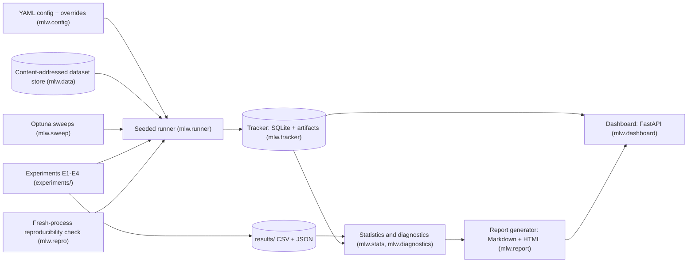

<p align="center"></p>

<p align="center">
  
  
  
</p>

# Machine Learning Research Workbench

> Reproducible experiments with honest statistics: track, tune, compare and report.

A workbench that makes machine-learning experiments reproducible by default and comparisons statistically honest. Every run records its parameters, a content hash of the code, the dataset hash and an environment fingerprint; every comparison reports intervals across seeds, not a single lucky number. It is a local, single-machine tool built and tested on a shared Windows machine; it has not been published or deployed anywhere.

**Quick links:** [Architecture](#architecture) · [Tech stack](#tech-stack) · [Engineering decisions](#engineering-decisions) · [Roadmap](#roadmap) · [Case study](docs/case-study.md) · [Research report](docs/research-report.md)

> **Public showcase.** This repository holds the documentation, client case study, research report and measured results for this product. The runnable source code is distributed separately under a license: see [SOURCE-ACCESS.md](SOURCE-ACCESS.md).

## At a glance

|  |  |
|---|---|
| **Track** | Research · Advanced |
| **Phase** | Beta: all five milestones work, 93 tests pass from a clean install, and all four experiments have recorded results. Single-machine, unpublished, not deployed. |
| **Primary reader** | Researchers and technical reviewers |
| **Read next** | [README](README.md) · [Client case study](docs/case-study.md) · [Research report](docs/research-report.md) |

## Why this exists

Most ML results cannot be reproduced and many reported improvements fall inside seed-to-seed noise. Experiment tracking tools record runs but rarely help you decide whether model A is actually better than model B.

## What it does

Everything listed here is implemented and covered by automated tests.

- **Run tracking** (`mlw.tracker`): one `Tracker` interface with a SQLite implementation and an in-memory one. Each run stores parameters, metrics, artifacts, a content hash of the workbench sources (there is no git requirement), the dataset hash and an environment fingerprint (Python, platform string, package versions, thread count, `uv.lock` hash). Only relative paths are stored.
- **Config-driven runs with deterministic seeding** (`mlw.config`, `mlw.seeding`): YAML plus `key=value` overrides, strictly validated; seeds derive from labelled hashes; BLAS/OpenMP threads are pinned (default 1).
- **Dataset versioning** (`mlw.data`): content-addressed store with a manifest (source, version, licence, rows, columns, synthetic flag), tamper detection, and lineage for derived datasets. A fallback to scikit-learn's bundled data is used if a download fails.
- **Reproducibility check** (`mlw.repro`, `mlw repro-check`): runs a five-model reference experiment twice in fresh interpreter processes with a minimal environment and asserts metrics equal within a declared tolerance (0 by default; bit-exact on CPU in the tests).
- **Fixed-budget sweeps** (`mlw.sweep`, `mlw sweep`): seeded, sequential Optuna TPE studies with an exact trial budget; the incumbent after b trials is read from one trial history (tested equal to a budget-b study).
- **Statistics** (`mlw.stats`, `mlw.diagnostics`): bootstrap CIs (percentile and BCa), paired bootstrap, Wilcoxon and paired t, Cohen's d, Cliff's delta, Holm and Bonferroni, Kendall tau, pairwise disagreement, Wilson intervals, exact paired-t power, "seeds needed" calculator and seed-subsample curves. Validated against simulations (see Verification).
- **Reports** (`mlw.report`, `mlw report`): Markdown and HTML with per-dataset tables, Holm-corrected paired comparisons, seeds-needed estimate, SVG plots, and an embedded provenance block (run IDs, code hash, environment hash, dataset hashes).
- **Dashboard** (`mlw.dashboard`, `mlw dashboard`): small read-only FastAPI app with a JSON API and a single HTML page over the tracker.
- **Experiments E1 to E4** (`experiments/`): the four studies of the [research report](docs/research-report.md), each runnable with one command.

## Results at a glance

Measured by the scripts in `experiments/` on five small public tabular datasets, five model families, one shared CPU machine. Full tables, definitions and caveats are in the [research report](docs/research-report.md); the raw files are in `results/`.

| Experiment | Headline (95% CI) | Verdict |
|---|---|---|
| E1 variance audit | Median seed SD of accuracy 0.0204 versus median gap between adjacent-ranked models 0.0054; ratio 3.77 (1.82 to 5.46) | H1 supported (untuned defaults, small test sets) |
| E2 seed sufficiency | One seed disagrees with a disjoint 20-seed ranking on 0.235 of model pairs (0.120 to 0.343) | H2 inconclusive: point estimate above the 0.20 threshold, interval crosses it |
| E3 budget fairness | A threefold budget change flips 0.136 of affected winners (0.097 to 0.180) versus a noise floor of 0.122 (0.078 to 0.172) | H3 not supported |
| E4 cross-environment | Same environment: 75 of 75 runs bit-identical across a fresh process and 2 threads. Older library stack: 30 of 75 bit-identical, 72 of 75 within the 0.01 accuracy tolerance | H4 not supported (3 HistGradientBoosting runs outside tolerance); software environments on one machine, not hardware |

## Architecture



## Tech stack

What was actually used (the original plan named PyTorch, Hydra, MLflow, DVC, Docker and Streamlit or React; those were replaced as shown).

| Layer | Technology | Replaces in the plan |
|---|---|---|
| Core | Python 3.12, NumPy, pandas, scikit-learn | PyTorch (the neural family is scikit-learn's `MLPClassifier`, to keep install and CPU runtime small) |
| Models | logistic regression, random forest, HistGradientBoosting, LightGBM, MLP | |
| Experiments | Optuna, YAML configs with dotted overrides, uv with a lockfile | Hydra |
| Tracking | Own SQLite tracker behind one interface (plus in-memory) | MLflow |
| Data versioning | Own content-addressed store with a lineage manifest | DVC |
| Statistics | SciPy plus own bootstrap, effect-size, Holm and power utilities | statsmodels (not used) |
| Dashboard and reports | FastAPI + one static HTML page; matplotlib SVG figures; Markdown and HTML reports | React or Streamlit; PDF output |
| Quality | pytest, hypothesis, mypy (strict), Ruff, GitHub Actions workflow (never run) | |
| Container | `Dockerfile` **written, never built** (the Docker daemon was not running) | container reproducibility |

## Engineering decisions

### Seeds are a first-class dimension

Every experiment is defined as model x dataset x seed, and results are aggregated and compared across seeds by default. The seed can control the split and model randomness together or the model alone (`variance_source`), which separates the two sources of variance.

### Tuning budget is part of the experiment

Compared models receive recorded hyperparameter-search budgets, and the budget experiment (E3) manipulates them on purpose. Studies are sequential and seeded so a budget-b result is a prefix of a longer study.

### Reproducibility is tested, not promised

A test re-runs a reference experiment in fresh processes with a clean environment and asserts equal metrics. Cross-environment behaviour is *measured* (E4) rather than assumed, and is reported as two software environments on one machine, not as different hardware.

### Statistics are validated against known truth

Coverage of the bootstrap intervals, familywise error of Holm, effect-size recovery, test size and power, and the seed-count calculator are all checked against simulations with known answers, with property-based tests on top.

## Not built yet / out of scope

| Item | Why |
|---|---|
| PyTorch models, GPU runs | Install size and runtime on a shared CPU-only machine; the neural family is an scikit-learn MLP. GPU determinism is untested. |
| Hydra, MLflow, DVC integrations | Replaced by a smaller documented config system, tracker and dataset store; the tracker interface is where an MLflow adapter would plug in. |
| Image datasets (CIFAR-10 subset) | Out of scope for CPU budget; the benchmark set is five small tabular datasets. |
| PDF reports | Markdown and HTML only. |
| Container reproducibility | A `Dockerfile` exists but was never built or run; no claim is made. |
| Cross-hardware reproducibility | Only one machine was available. |
| CI execution | `.github/workflows/ci.yml` runs the same commands as Verification but has never been run. |
| Authentication, write access or multi-user use of the dashboard | Read-only local tool by design. |

## Roadmap

- [x] M1: tracker, config system and deterministic seeding
- [x] M2: dataset versioning and fresh-process reproducibility test
- [x] M3: sweeps with fixed budgets
- [x] M4: statistical comparison and variance diagnostics
- [x] M5: report generator and dashboard

## Getting started

> _These instructions refer to the source package, which is distributed separately and is not part of this showcase repository._

Prerequisite: [uv](https://docs.astral.sh/uv/). Every command below except the last was run from a clean state: a copy of the folder (without `.venv`, `.tmp`, `data/`, `runs/` and `reports/`) placed at a short path. The last one, `experiments.all`, was run in the development folder; its first attempt stopped at E4 after a native crash of a worker process, E4 was rerun and the tables rendered separately (see the change log in the research report), so it has not completed in one go.

```bash
uv sync                                           # locked environment, Python 3.12
uv run mlw run --config configs/reference.yaml    # one seeded run, logged to ./runs
uv run mlw run model.name=rf seed=3               # override any config key
uv run mlw demo --seeds 10                        # 5 models x 10 seeds on the bundled breast-cancer data
uv run mlw compare --experiment demo              # paired comparisons with Holm correction
uv run mlw report --experiment demo --out reports/demo   # report.md, report.html, figures
uv run mlw sweep --dataset breast_cancer --model rf --budget 10
uv run mlw repro-check                            # fresh-process reproducibility check
uv run mlw data list                              # dataset store (content hashes, sources)
uv run mlw dashboard                              # http://127.0.0.1:8000 (checked with curl and in a browser)
uv run python -m experiments.all                  # E1 to E4 once, then render the report tables
```

Generated data (`data/`, `runs/`, `reports/`, `.tmp/`) is gitignored. OpenML datasets are downloaded on first use. On one Windows machine the Python build crashed when loading the system certificate store; `mlw.data` installs an in-memory certificate loader on Windows (verification stays on). `MLW_THREADS` (see `.env.example`) sets the thread count.

## Verification

> _These instructions refer to the source package, which is distributed separately and is not part of this showcase repository._

```bash
uv run ruff check .
uv run ruff format --check .
uv run mypy
uv run pytest
```

From the clean short-path copy: ruff and `ruff format --check` clean, `mypy --strict` clean on 32 source files, 93 tests passed in about 2.5 minutes. The tests include property-based tests (hypothesis), a fresh-process bit-exact reproducibility test, and simulation validation of the statistics (bootstrap-CI coverage for the mean of a normal and of an exponential sample, Holm familywise error and power cost, Cohen's d and Cliff's delta against analytic values, Wilcoxon and paired-t test size, and the seeds-needed calculator against simulated power). A hygiene test scans the repository for absolute paths, user names and unresolved placeholders. The CI workflow runs the same four commands but has never been executed.

## Repository layout

> _These instructions refer to the source package, which is distributed separately and is not part of this showcase repository._

```text
src/mlw/          library: tracker, config, data, models, runner, sweep, stats, diagnostics, report, dashboard, repro, cli
experiments/      E1-E4 scripts, common protocol constants, table renderer, run-everything entry point
configs/          reference.yaml
tests/            unit, property-based and simulation-validation tests
docs/             case study, research report, assets
results/          raw experiment output (CSV/JSON), summaries, rendered tables
```

## Skills demonstrated

`Experimental design` · `Applied statistics` · `Reproducible research engineering` · `scikit-learn and gradient boosting` · `MLOps fundamentals` · `Scientific communication`

## One project, three lenses

The same project is documented for three audiences, so one body of work serves every goal.

| If you are… | Read | You will find |
|---|---|---|
| Hiring or reviewing engineers | [This README](README.md) | Architecture, trade-offs, quality bar and what I would defend in a design review |
| A client or founder | [Client case study](docs/case-study.md) | The business problem, the value levers, how it is measured and how an engagement runs |
| A researcher or technical reviewer | [Research report](docs/research-report.md) | Hypotheses, methods, statistical plan, results and the reproducibility checklist |

## Author

Built by **[The Diamond Empire](https://thedempire.shop/)**.
