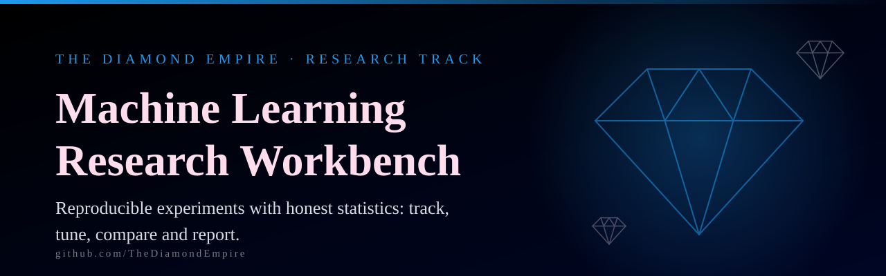

# Machine Learning Research Workbench: Client Case Study

> Experiments you can reproduce, comparisons you can defend and reports that write themselves.

> **Status of this document.** This is a reference case study: it sets out the business problem, the solution and the value model. The results table is intentionally blank and is filled in only from measured data (a pilot or a real engagement). No outcome figures are claimed here. The research results about the workbench itself (variance, seed counts, budgets, reproducibility) are in the [research report](research-report.md), measured on public benchmark datasets and not on any client work.

## Snapshot

|  |  |
|---|---|
| **Who it is for** | University labs, R&D teams and data-science groups that need results they can defend. |
| **Solution** | Reproducible experiments with honest statistics: track, tune, compare and report. |
| **Track** | Research · Advanced |
| **Delivered by** | The Diamond Empire |

## The challenge

Papers and internal reports cannot be reproduced six months later, model comparisons are decided by single runs, and reviewers ask for variance that was never recorded.

## The solution

A workbench that makes machine-learning experiments reproducible by default and comparisons statistically honest. Every run captures code, data, config and environment; every comparison reports intervals across seeds, not a single lucky number.

What the client gets in practice:

- Run tracking: parameters, metrics, artifacts, a content hash of the code, the data hash and an environment fingerprint (versions plus lockfile hash) for every run
- Config-driven experiments (YAML plus command-line overrides) with deterministic seeding and a fresh-process reproducibility check
- Dataset versioning with content hashes and lineage
- Hyperparameter search (Optuna) with a fixed, reported tuning budget per model
- Statistical comparison: bootstrap confidence intervals, paired tests across seeds, effect sizes and multiple-comparison correction
- Seed-count diagnostics, Markdown and HTML reports, and a small read-only dashboard of runs and comparisons

## How it creates value

| Value lever | How the solution delivers it | How we measure it |
|---|---|---|
| Credibility | Intervals and tests replace single-run claims | Reviewer or stakeholder challenges answered with data |
| Rework avoided | Everything needed to rerun an experiment is captured automatically | Hours to reproduce a prior result |
| Compute efficiency | Seed-count diagnostics prevent both under- and over-running | Compute-hours (CPU or GPU) per conclusion |
| Reporting time | Reports are generated from tracked runs | Hours from last run to finished report |

## How an engagement runs

| Phase | What happens |
|---|---|
| Audit | Current experiment practice and reproducibility gaps |
| Install | Tracker, configs and environment locks |
| Migrate | Key past experiments rerun and verified |
| Adopt | New projects start on the workbench |

## What the client receives

- Workbench installed in the client’s environment
- Migration of existing experiments into the tracker
- Reference experiment and a reproducibility check wired into the client's CI
- Team training on seed-aware comparison
- Report templates matching the client’s format

## Results

Baseline measurements are taken **before** the solution goes live, and the same measures are taken after, so every change in the table is attributable and honest.

| Measure | How measured | Baseline | After | Change |
|---|---|---|---|---|
| Credibility | Reviewer or stakeholder challenges answered with data | — | — | — |
| Rework avoided | Hours to reproduce a prior result | — | — | — |
| Compute efficiency | Compute-hours (CPU or GPU) per conclusion | — | — | — |
| Reporting time | Hours from last run to finished report | — | — | — |

> **To fill in:** replace each — with measured values and add the measurement window and sample size beneath the table.

## How quality and risk are managed

- Reference experiment re-run in fresh processes and asserted identical on CPU (tolerance declared, zero by default); GPU behaviour has not been tested
- Statistical utilities validated against known simulations (coverage of confidence intervals, familywise error of the correction, effect sizes)
- Type-checked, linted and unit-tested core library
- Every report embeds the run IDs, code content hash, environment hash and dataset hashes it was built from

## Is this a fit?

Best suited to: university labs, R&D teams and data-science groups that need results they can defend.

## Talk to me

Want this adapted to your business? Get in touch via **[thedempire.shop](https://thedempire.shop/)**.

---

[README](../README.md) · [Client case study](case-study.md) · [Research report](research-report.md)
